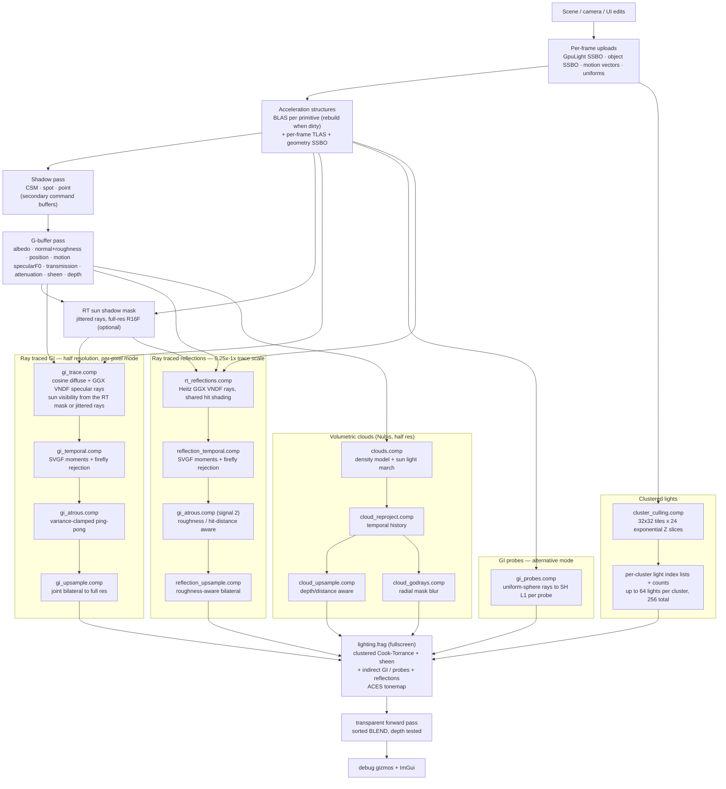

# MukkiRebornEngine

A vendor-agnostic game engine: C++20, Vulkan 1.4 (vulkan.hpp + VMA), deferred rendering, Slang
shaders and an ImGui docking UI. Rewrite of an older Vulkan renderer into a proper engine.

## Photo ShowCase of Progress


## Requirements

- CMake 3.25 or newer
- [vcpkg](https://github.com/microsoft/vcpkg), with the `VCPKG_ROOT` environment variable set
- Visual Studio 2022+ with the "Desktop development with C++" workload (Windows), or a C++20
  compiler with Ninja (Linux)
- Vulkan SDK 1.4 or newer, for `slangc` (Vulkan headers and the loader come from vcpkg)
- Git

## Setup

Set `VCPKG_ROOT` once so the CMake presets can find the vcpkg toolchain:

```powershell
# Windows (persistent, restart your terminal afterwards)
[Environment]::SetEnvironmentVariable('VCPKG_ROOT', 'C:\path\to\vcpkg', 'User')
```

```sh
# Linux
echo 'export VCPKG_ROOT=$HOME/vcpkg' >> ~/.bashrc
```

Dependencies are declared in `vcpkg.json` and installed automatically in manifest mode on the first
configure into `build/<preset>/vcpkg_installed`. That first configure can take several minutes while
vcpkg builds the dependencies. `tinygltf` is pinned to 2.9.3 because the 3.0.0 port hash no longer
matches GitHub's regenerated tarball.

Sample assets live in a submodule (about 1.7 GB, cloned shallow):

```sh
git clone --recurse-submodules <repository-url>
# or, in an existing checkout
git submodule update --init --depth 1
```

Without the submodule the engine still builds and tests pass, but the default demo scene cannot
load its models.

Shader compilation uses `slangc` from the Vulkan SDK, found through the `VULKAN_SDK` environment
variable (or on `PATH`). If `slangc` is missing, CMake prints a warning, shader targets are skipped
and the sandbox will fail to load its shaders.

Compiled SPIR-V is reflected with [SPIRV-Reflect](https://github.com/KhronosGroup/SPIRV-Reflect)
when a shader is loaded (`rhi::Shader::GetReflection`). Descriptor set layouts
(`rhi::MergeShaderReflectionBindings`), vertex input layouts and push constant ranges
(`rhi::ApplyShaderReflection`) are generated from the shader interface instead of being declared by
hand. The bindless texture set is the only hand-written layout because update-after-bind descriptor
indexing and runtime arrays cannot be expressed in reflection.

## Build

Windows (Visual Studio generator, Debug or Release):

```powershell
cmake --preset windows-debug
cmake --build --preset windows-debug
ctest --preset windows-debug
```

Linux (Ninja):

```sh
sudo apt-get install ninja-build xorg-dev libgl1-mesa-dev

cmake --preset linux-debug
cmake --build --preset linux-debug
ctest --preset linux-debug
```

Use the `*-release` presets for optimized builds. The presets in `CMakePresets.json` use the
"Visual Studio 18 2026" generator; with another Visual Studio version, configure manually instead:

```powershell
cmake -S . -B build -G "Visual Studio 17 2022" -A x64 `
  -DCMAKE_TOOLCHAIN_FILE="$env:VCPKG_ROOT/scripts/buildsystems/vcpkg.cmake"
cmake --build build --config Debug
ctest --test-dir build -C Debug --output-on-failure
```

CMake options:

- `MRE_BUILD_SANDBOX` (default `ON`) - build the sandbox executable
- `MRE_BUILD_TESTS` (default `ON`) - build the GoogleTest unit tests

## Run

The sandbox renders a deferred scene (G-buffer pass + PBR lighting pass with ACES tonemapping) with
an ImGui overlay, including a debug window showing the G-buffer channels. On ray tracing capable
GPUs the lighting is augmented with ray traced global illumination. Compiled Slang shaders are
copied next to the executable automatically.

```powershell
.\build\windows-debug\Debug\mukki_sandbox.exe
```

Pass `--frames N` to run a fixed number of frames and exit (used for smoke testing). Pass
`--model <path>` to load a specific glTF/GLB file instead of the default scene, `--scene <path>`
to load a JSON scene (compiled to bytecode next to the executable, see [Scenes](#scenes)), or
`--env <path>` to use a Radiance `.hdr` equirectangular environment map for the image based
lighting (a sample lives in `AssetLibrary/lakeside_sunrise_2k.hdr`).

Controls: `WASD`/`QE` to move, mouse to look, `Shift` to move faster, `Tab` to toggle the cursor for
UI interaction (or hold `Left Alt`), `Esc` to quit.

The sandbox has a scene browser window listing the JSON scenes in `Sandbox/Scenes`, a scene window
with the light editor, a G-buffer debug window, and an ImGui demo window. glTF objects loaded from a
scene are auto-fitted to the ground plane.

## Rendering pipeline

One command list per frame; the shadow and G-buffer draw calls are recorded into secondary command
buffers on worker threads and replayed from the primary list. Clustered lighting and ray traced GI
converge in the fullscreen `lighting.frag` pass:



- **Clustered lights**: every light is uploaded once per frame; the culling compute shader bins them
  into a `32x32` tile by 24 exponential-depth-slice grid, and the lighting pass only iterates the
  index list of the cluster a fragment falls into.
- **GI**: the per-pixel trace shoots `Trace samples` diffuse+specular path pairs at half resolution,
  then the SVGF chain denoises it. When probes are enabled the per-pixel trace is skipped and the
  probe SH irradiance is blended instead, so indirect light is never counted twice.
- **Reflections**: a separate trace/denoise chain at the configurable trace scale; it shares the
  a-trous kernel with GI and fades into the GI specular signal at the roughness cutoff.
- **Lighting** composites direct clustered lights, indirect GI (or probes) and reflections in one
  pass, applies ACES tonemapping, and transparent `BLEND` geometry is drawn over the result.

## Scenes

Scenes are authored as JSON and compiled into compact little-endian bytecode (magic `MRES`) that the
engine loads at runtime. The JSON is the source format; the bytecode is the only scene format the
renderer reads.

### Authoring

A minimal scene:

```json
{
  "name": "My Scene",
  "assetRoot": "assets/models",
  "objects": [
    {
      "name": "Helmet",
      "model": "DamagedHelmet/glTF/DamagedHelmet.gltf",
      "position": [0.0, 0.0, 0.0],
      "rotation": [0.0, 45.0, 0.0],
      "scale": [1.0, 1.0, 1.0]
    }
  ],
  "lights": [
    {
      "name": "Sun",
      "type": "directional",
      "direction": [-0.4, -1.0, -0.3],
      "color": [1.0, 0.97, 0.92],
      "intensity": 0.6
    },
    {
      "name": "Lamp",
      "type": "point",
      "position": [2.0, 2.0, 0.0],
      "color": [1.0, 0.4, 0.2],
      "intensity": 1.5,
      "range": 5.0
    },
    {
      "name": "Cone",
      "type": "spot",
      "position": [0.0, 3.5, 0.0],
      "direction": [0.0, -1.0, 0.0],
      "color": [0.3, 0.6, 1.0],
      "intensity": 3.0,
      "range": 9.0,
      "innerConeAngle": 20.0,
      "outerConeAngle": 35.0
    }
  ]
}
```

- `assetRoot` is optional; relative `model` paths are resolved against it. It defaults to the
  directory containing the JSON file.
- `rotation` is Euler degrees applied in YXZ order. `position` and `scale` are in world units.
- Light `type` is `directional`, `point` or `spot`; cone angles are degrees. Point and spot lights
  use `range`, directional lights ignore `position`/`range`, and point lights ignore `direction`.
- Up to 256 lights (`kMaxLights`) and any number of glTF objects are supported. Models referenced
  more than once are loaded once and instanced.
- `Sandbox/Scenes/demo.scene.json` is a complete example with 7 glTF objects and 25 lights.

### Compiling

`mukki_scene_compiler` converts a JSON scene into bytecode:

```powershell
# writes Sandbox\Scenes\demo.scene.mres
.\build\windows-debug\Debug\mukki_scene_compiler.exe Sandbox\Scenes\demo.scene.json

# explicit output and asset root override
.\build\windows-debug\Debug\mukki_scene_compiler.exe scene.json out\scene.mres --asset-root assets\models
```

Without an output path the bytecode is written next to the JSON file, replacing the `.json` extension
with `.mres`.

### Loading scenes from the command line

The sandbox compiles the JSON to bytecode next to the executable (`<exe>\scenes\<name>.mres`) and
then loads only that bytecode:

```powershell
# default: Sandbox/Scenes/demo.scene.json -> <exe>\scenes\demo.scene.mres
.\build\windows-debug\Debug\mukki_sandbox.exe

# any scene JSON
.\build\windows-debug\Debug\mukki_sandbox.exe --scene C:\scenes\city.scene.json

# smoke test a scene for a fixed number of frames
.\build\windows-debug\Debug\mukki_sandbox.exe --scene Sandbox\Scenes\demo.scene.json --frames 240
```

### Shadows

The renderer implements shadow mapping for all light types:

- **Directional**: 4 cascades at 1024x1024 (`D32Sfloat`) with exponential/uniform blended splits,
  sphere-fitted ortho projections and texel snapping to avoid shimmering. The first directional
  light with `"castShadows": true` (JSON, default `true`) is used.
- **Spot**: up to 4 perspective shadow maps (1024x1024) in a `Texture2DArray`; the projection
  covers the light cone plus a small margin.
- **Point**: up to 2 lights, each with six 512x512 perspective faces packed into a 2D atlas
  (1536x2048). The lighting pass picks the face from the major axis of the light-to-fragment
  vector and filters inside the atlas tile.
- All shadow views are rendered in one shadow pass, recorded into secondary command buffers on
  worker threads like the G-buffer pass. Spot and point views cull objects by light range using
  per-instance bounding spheres.
- The lighting pass filters with hardware comparison samplers (3x3 PCF) and a whole-shadow-map
  normal bias.
- Alpha-masked materials (glTF `MASK`) are cut out in both the G-buffer and the shadow pass, so the
  chain rails and foliage in Sponza cast shaped shadows instead of solid quads.
- On ray tracing hardware the `Shadows` section can switch the sun to **ray traced sun shadows**
  (`RT shadow samples`, `RT sun angular radius`): a compute pass traces jittered rays from the
  G-buffer and the lighting pass reads the resulting full-resolution visibility mask instead of the
  cascades. Spot and point lights keep using shadow maps.

The `Scene` window exposes `Enabled`, `Distance`, `Depth bias` and `Normal bias` sliders for
tuning, and every light editor has a `Casts shadows` checkbox (subject to the spot/point slot
budgets above).

### Global illumination

On GPUs with ray query support the renderer adds path-traced global illumination on top of the
clustered lights:

- One bottom-level acceleration structure per glTF primitive plus one for the ground plane; a
  top-level structure with per-instance transforms is rebuilt every frame from the motion-vector
  object data.
- The trace pass runs at half resolution (adjustable 0.25x-1x) and shoots cosine-weighted diffuse
  rays plus GGX VNDF specular rays (`Trace samples` path pairs per pixel). Sun visibility uses the
  smoothed ray traced sun shadow mask when it is enabled and falls back to `sunShadowSamples`
  jittered rays within `Sun angular radius` otherwise. Hits are shaded with the bindless material
  textures, and the previous frame's indirect result feeds multi-bounce energy back in.
- Fireflies are rejected against the accumulated moments (mean + 4 sigma) before the history
  clamp, the a-trous taps are clamped to the center variance, and the history accumulates up to 64
  frames (`Temporal alpha min`).
- **Materials**: glTF `alphaMode = MASK` and `KHR_materials_specular` are supported, so the Khronos
  `SpecularTest` grid shows the dielectric F0 variation in both the analytic specular and the ray
  traced reflections (`--model <SpecularTest.gltf>`).
- **Glass**: `alphaMode = BLEND` materials render in a sorted forward pass over the lit image.
  Physically based glass (`KHR_materials_ior`, `transmission`, `volume`, `dispersion`) keeps its
  surface in the G-buffer and resolves reflection/refraction through the ray traced specular pass
  with up to `Refraction bounces` dielectric bounces, Beer-Lambert `Volume absorption` and optional
  `Dispersion`; glass seen in reflections, GI and probes refracts consistently.
- **Ray traced reflections**: surfaces below `Reflection max roughness` trace `Reflection samples`
  Heitz GGX VNDF rays (height-correlated Smith weighting) at `Reflection trace scale` of the
  swapchain (default full resolution), shade the hits with the shared path tracer, accumulate
  temporally (with the same denoiser settings as GI), filter through the GI a-trous and bilaterally
  upsample to full resolution. The GI specular signal fades out where the reflection pass takes
  over, so the specular integral stays energy consistent. Controls: `Reflections`,
  `Reflection intensity`, `Reflection max roughness`, `Reflection distance`, `Reflection samples`,
  `Reflection trace scale`.
- **Punctual lights in GI**: point and spot lights are evaluated at ray hit points with the shared
  Cook-Torrance BRDF (`GI light count` caps them at `kMaxGiLights`) and one ray traced shadow ray
  per light, so lamps bleed their color into indirect lighting, probes and reflections consistently
  with the analytic lighting pass.
- **Volumetric clouds (Nubis)**: a Decima-style ray marched cloud layer fills the sky with
  stratus/cumulus/cumulonimbus/cirrus types. The Perlin-Worley 3D noise, detail and curl textures
  plus a procedural weather map are generated in-engine on the JobSystem at startup (no authored
  assets; ~4 s Debug, <1 s Release). The half-resolution trace (0.25x-1x) reads the G-buffer
  depth, applies curl distortion and height gradients per cloud type, light-marches toward the sun
  (cone sampling, dual-lobe HG, double Beer-Lambert and powder), temporally reprojects per frame
  and upsamples depth/distance-aware;
  god rays radially blur the sun-occlusion mask. Clouds composite over the sky in the lighting
  pass only (no cloud shadows on geometry yet). Controls: `Clouds`, `Coverage`, `Cloud type`,
  `Density`, `Detail erosion`, `Coverage variation`, layer/altitude, `Wind speed`/`direction`,
  `Curl strength`, `Primary/Light steps`, `Cloud trace scale`, `Cloud temporal blend`, `God rays`.
- **Emissive materials**: glTF `emissiveFactor` (scaled by `KHR_materials_emissive_strength`) and
  `emissiveTexture` are lit into the HDR image before tonemapping, in the transparent forward pass,
  and in ray traced hits (so emissive surfaces glow in GI and reflections).
- **Image based lighting**: the `Environment (IBL)` controls drive a parametric gradient sky that
  provides diffuse SH irradiance, prefiltered specular reflections (split-sum with a BRDF LUT), the
  visible sky background (with a sun disc) and the sky term of the GI/reflection/probe rays.
  A Radiance `.hdr` equirectangular map can replace the gradient (`HDR map` dropdown listing the
  maps found in `AssetLibrary/`, or `--env <path>`); the SH coefficients are re-projected from the
  image on load. Controls: `Image based lighting`, `Sky intensity`, `HDR map`,
  `Sky zenith`/`horizon`/`ground`, `Sun disc`. Without IBL the flat ambient term is used.
- **GI probes**: world space probes added from the `Probes` section (independent of the glTF objects)
  feed the irradiance probe pass. `gi_probes.comp.slang`
  traces `Probe rays` uniform-sphere rays per probe with the same hit shading as the path tracer,
  projects the result onto SH L1 and blends it with the previous frame (`Probe hysteresis`). The
  lighting pass blends the surrounding probes by inverse distance, and the per-pixel trace/denoiser
  is skipped while probes are active (`Use probes for GI`) so the indirect lighting is not counted
  twice. Place several probes around the scene for smooth indirect; they update every frame and
  reset their accumulation when moved.
- A hand-rolled SVGF denoiser accumulates edge-aware temporally (depth, normal, luminance and
  hit-distance rejection, variance from the first two moments), then runs 4 iterations of a
  depth/normal/roughness-aware a-trous filter and a joint bilateral upsample back to full
  resolution. Diffuse and specular are denoised as separate signals.
- Storage textures stay in the `GENERAL` layout for their whole lifetime and are transitioned once
  at creation; each a-trous iteration owns its descriptor set because updating a set that is bound
  to a recording command buffer invalidates that command buffer.

The `Scene` window exposes the GI controls: `Ray traced GI`, `Trace scale`, `GI intensity`,
`Max ray distance`, `Bounce feedback`, `Specular min roughness`, the temporal/edge-stop
parameters, `A-trous iterations`, `Sun shadow ray` and the punctual-light controls
(`Point/spot lights in GI`, `GI light count`, `GI light shadows`, `GI light shadow bias`). Devices
without ray tracing report `(ray tracing unavailable)` and render the clustered lights only. The
`Volumetric clouds (Nubis)` section hosts the coverage/type/density, layer, wind/curl, step count,
trace scale, temporal blend and god-ray controls.

In the sandbox, the `Scenes` window browses and loads the JSON scenes found in `Sandbox/Scenes`
(with a global transform scale). The `Scene` window lists the loaded objects and lights:

- Selecting an object lets you edit its position, rotation (degrees, YXZ) and scale; the change is
  applied to the renderer immediately. The `Probes` section below the objects manages the
world-space GI probes (`Add probe` places one in front of the camera, `Add grid` drops a 3x2x3
grid, `Fill scene`/`Maximize probes` distribute probes across the loaded scene bounds up to the
GPU limit of `kMaxGiProbes`, and the selected probe has position/radius/enabled controls); they
are persisted in the scene JSON and bytecode.
- Selecting a light opens a `Type` dropdown (directional/point/spot) plus position, direction,
  color, `Strength`, range and cone controls.
- `Show light gizmos` draws wireframe markers for the lights in the viewport: range spheres for
  point lights, inner/outer cones and a direction line for spot lights, and an arrow plus ring for
  the sun. `Show probe gizmos` toggles the probe markers.

`Reload JSON -> bytecode` recompiles the source file, `Compile bytecode` writes the current
in-memory edits to `<exe>\scenes\<name>.mres`, and `Save JSON` dumps them back to
`<exe>\scenes\<name>.json`.

## Layout

- `Application/` - windowing, input, keybinds, camera, ImGui styles
- `Assets/` - asset loading (glTF via tinygltf, KTX2 planned)
- `Core/` - engine core (version, time)
- `Renderer/RHI/` - vendor-agnostic render hardware interface (device, command lists, resources)
- `Renderer/Vulkan/` - Vulkan backend implementation
- `Renderer/Debug/` - world-space debug line builder (light/probe gizmos)
- `Renderer/Deferred/` - deferred renderer (G-buffer, lighting, tonemapping)
- `Renderer/GlobalIllumination/` - ray traced GI settings, uniforms and the a-trous schedule
- `Renderer/Lighting/` - light types and the clustered light grid
- `Renderer/Shaders/` - Slang shaders compiled at build time
- `Renderer/BufferManager` - vertex/index/uniform buffer management
- `Scene/` - scene description, JSON authoring (nlohmann/json) and `MRES` bytecode
- `Tools/` - command line tools (`mukki_scene_compiler`)
- `ThirdParty/` - submodules (glTF sample models)
- `Utilities/` - logging, asserts, future containers and allocators
- `Tests/` - GoogleTest unit tests
- `Sandbox/` - sandbox executable and `Scenes/demo.scene.json`

`Renderer/DX12/`, a render graph and KTX2 textures are planned.
